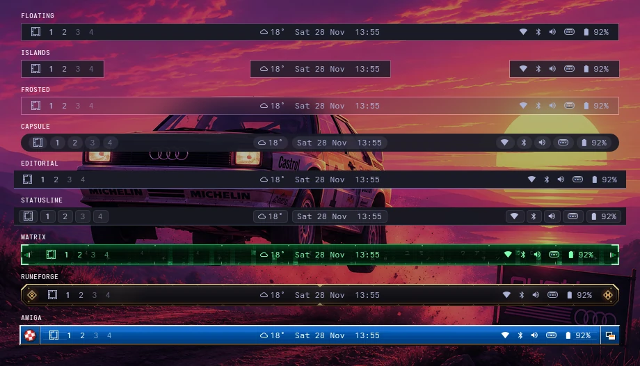
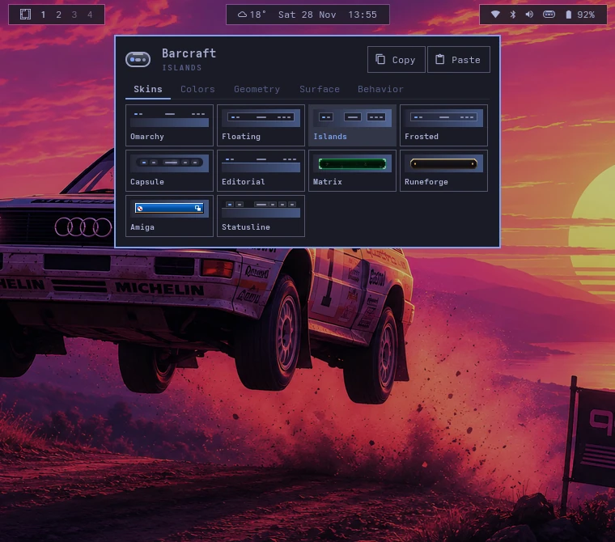
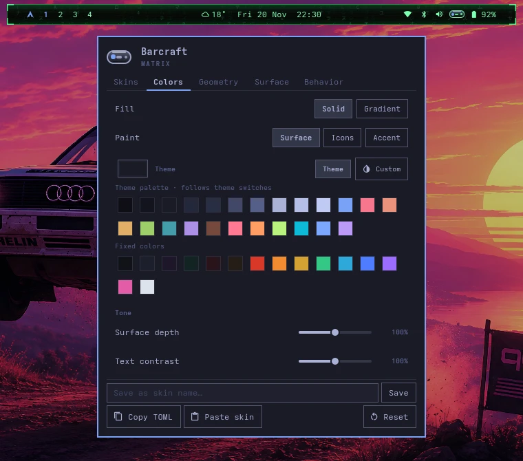
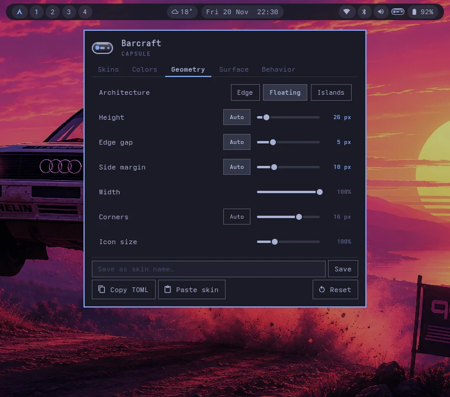
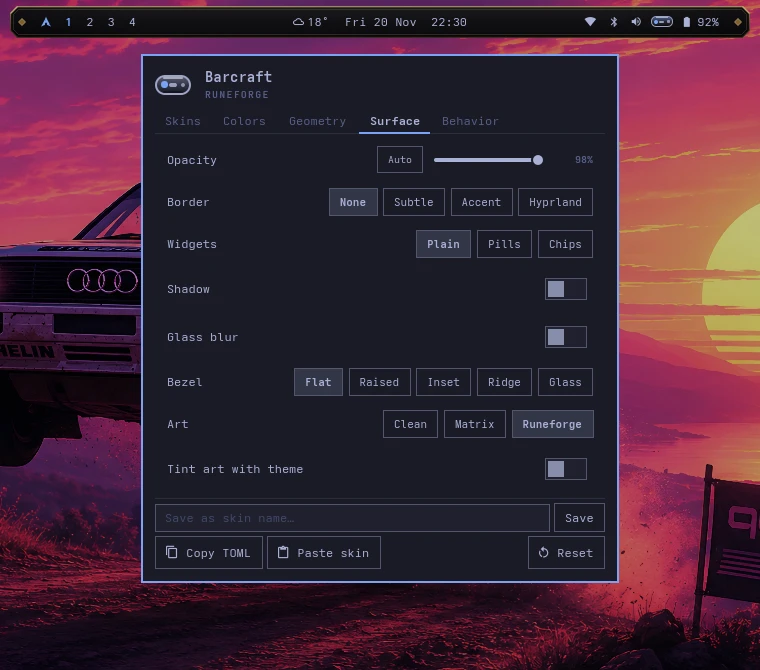
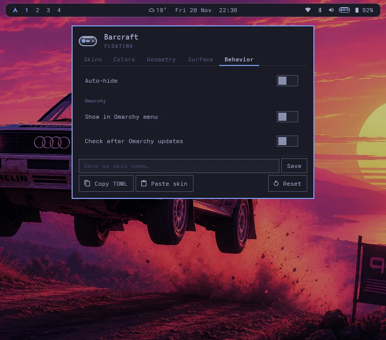

# Barcraft

[](https://github.com/thepixelgardener-create/barcraft/actions/workflows/ci.yml)
[](https://github.com/thepixelgardener-create/barcraft/releases/latest)
[](LICENSE)

**The skinnable bar for Omarchy.**

Barcraft (`thepixelgardener.barcraft`) layers a zero-motion skin engine and keyboard-driven Studio onto Omarchy's own bar. Every built-in and third-party `bar-widget`, popup, drag-and-drop layout, and multi-monitor setup keeps working unchanged, while settings live in `shell.json` and `"auto"` tokens follow your Omarchy theme and Hyprland geometry.



## What's included

- **9 built-in skins** — Classic: `Floating`, `Islands`, `Frosted`, `Capsule`, `Editorial`, `Statusline` *(compact 26px high-contrast developer bar with outlined widget chips)*. Wild Craft (still art): `Matrix`, `Runeforge`, `Amiga`.
- **Omarchy standard switch** — jump back to pixel-identical stock `omarchy.bar` anytime while keeping the Studio and saved skins ready.
- **Keyboard-first Studio** — hover or move the cursor (`hjkl`/arrows) to preview live, edit colors/geometry/surface/behavior, assign per-monitor skins, and copy/paste skins as TOML.
- **Theme-native & still** — live `theme.<key>` swatches follow theme switches with automatic WCAG 4.5:1 ink contrast and zero looping animations.

<details>
<summary>Studio screenshots (Skins · Colors · Geometry · Surface · Behavior)</summary>

<table>
  <tr>
    <td></td>
    <td></td>
  </tr>
  <tr>
    <td></td>
    <td></td>
  </tr>
  <tr>
    <td colspan="2" align="center"></td>
  </tr>
</table>

</details>

## Install

Requires **Omarchy 4 (Quattro)** with the Quickshell bar. No external dependencies or elevated privileges are required.

> **Barcraft replaces the bar.** Omarchy runs one bar at a time, so Barcraft can't run together with other bar plugins such as Station. A bar plugin's other features (services, widgets) only load while it is the active bar.

```bash
omarchy plugin add https://github.com/thepixelgardener-create/barcraft --enable
```

Barcraft switches to its bar and places the Studio button in the right section on first run. If you later remove the button and want it back, run `omarchy-shell barcraft restoreButton`.

From a local checkout: `ln -s "$PWD" ~/.config/omarchy/plugins/thepixelgardener.barcraft`, then `omarchy-shell shell rescanPlugins` and `omarchy bar use thepixelgardener.barcraft`.

### Remove

```bash
omarchy bar use omarchy.bar
omarchy plugin remove thepixelgardener.barcraft
```

## Making Skins

Every skin is a plain `[bar-skin]` TOML block. You can make one in three ways:

1. **In Barcraft Studio** — pick a starting preset, tweak colors, geometry, surface, or widgets live, then click **Save** (writes `~/.config/omarchy/bar/skins/<name>.toml`) or **Copy TOML** to share.
2. **As a standalone TOML file** — drop a `.toml` file into `~/.config/omarchy/bar/skins/`. Start from any built-in `preset` and override only what you want:

   ```toml
   [bar-skin]
   name         = "Dev Accent"
   preset       = "statusline"
   border       = "accent"
   border-alpha = 0.55
   ```

3. **Inside an Omarchy theme** — add a `[bar-skin]` section to your theme's `shell.toml` or a dedicated `shell.bar-skin.toml`. Omarchy ignores it without Barcraft, and Barcraft applies it automatically when **Follow theme skin** is on.

See the **[Skin Authoring Guide](docs/skins.md)** for the full `[bar-skin]` TOML reference, `"auto"` tokens, `theme.<key>` live colors, and adding custom `BarArtLayer` artwork.

## Docs & Links

- **[Skin Authoring Guide & TOML Reference](docs/skins.md)** — creating, sharing, theme-shipping, and contributing skins
- **[Keybindings, IPC, Omarchy Integration & Development](docs/reference.md)** — `bindings.lua`, `omarchy-shell barcraft` commands, files written, tests, and upstream sync
- **[Changelog](CHANGELOG.md)** — release history
- **[MIT License](LICENSE)** — built on Omarchy's bar and [omacom/omarchy-ui](https://github.com/omacom/omarchy-ui)
